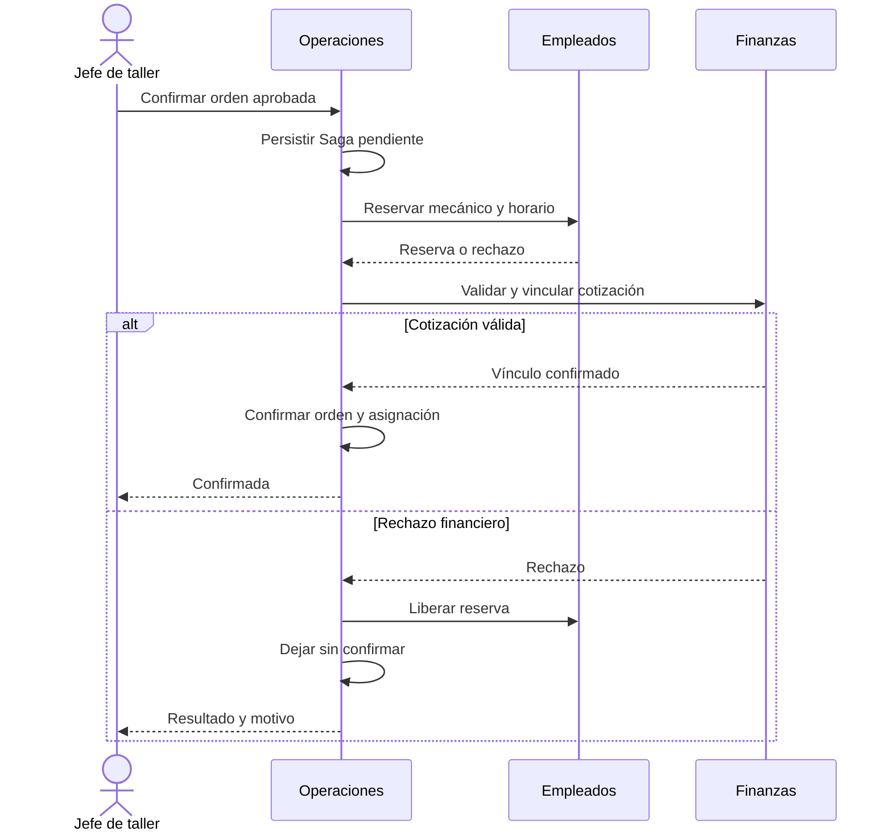

# 02 — Arquitectura, S3, Saga y MCP independiente
Fuente: https://app.notion.com/p/4032585d73c181dc94c5d17bb8c4bfd1?pvs=204
Copia local exportada el 2026-10-25. Revisar vigencia en Notion antes de cambiar decisiones; estados/relaciones propuestos no son aprobaciones.

## Componentes consolidados

Se establecen cinco microservicios: Operaciones, Empleados, Finanzas, Inteligencia y Sincronización. Un BFF compondrá la gestión web mediante GraphQL; REST atenderá móvil e integración interna. AutoNexus MCP Server será un componente adicional con proyecto y despliegue propios. Cada servicio mantendrá sus datos y reglas; no se accederá directamente a bases ajenas.

| Componente | Tecnología y persistencia | Responsabilidad y datos propios |
| --- | --- | --- |
| MS01 Operaciones | Spring Boot; PostgreSQL | Clientes, vehículos, citas, servicios, órdenes, avances, Saga y Outbox. |
| MS02 Empleados | NestJS; PostgreSQL propia | Personal, especialidades, jornadas, reservas de horario, asignaciones y Outbox. |
| MS03 Finanzas | PHP/Laravel; PostgreSQL propia | Cotizaciones versionadas, aprobaciones, cobros, gastos, vínculos y Outbox. |
| MS04 Inteligencia | Python/FastAPI; MongoDB | Resultados de inspecciones, predicciones, versiones, agentes y reportes; referencias a S3. |
| MS05 Sincronización | NestJS; DynamoDB | Sobres e intentos, estados, versiones, cursores y coordinación con propietarios. |
| BFF y entrada | NestJS; sin base de negocio | Composición GraphQL, adaptación REST y contexto autorizado. |
| MCP independiente | TypeScript + SDK MCP | Herramientas/recursos externos, autenticación, alcances y auditoría; sin lógica de agentes. |

## Web, móvil y entrada única

| Componente | Tecnología | Aplicación |
| --- | --- | --- |
| Shell web | single-spa | Navegación, montaje y sesión única. |
| MF01 Empleados | Angular | Personal, horarios y disponibilidad. |
| MF02 Operaciones | Angular | Clientes, vehículos, citas y órdenes. |
| MF03 Finanzas | React | Cotizaciones, cobros, gastos e indicadores. |
| MF04 Inteligencia | React | Inspecciones, asistencia y reportes. |
| Aplicación móvil | Flutter / Android | Agenda, avances, fotos e IA local offline. |

El Shell montará por rutas y permisos cuatro microfrontends independientes: empleados y operaciones en Angular; finanzas/reportes e inteligencia en React. La gestión web usará queries y mutations GraphQL, como consultarOrden, crearCotizacion y confirmarServicio. El BFF delegará en las APIs y Operaciones coordinará la Saga. REST atenderá móvil, contratos internos y autorización de archivos S3. El servidor MCP independiente consumirá esas APIs con permisos explícitos. Keycloak unificará la identidad mediante OpenID Connect: la web conservará la sesión entre microfrontends y Flutter tendrá su propio flujo. Cada API verificará rol, acción y acceso al registro. Operaciones, Empleados y Finanzas tendrán bases PostgreSQL separadas, con credenciales y migraciones propias. Inteligencia conservará en MongoDB predicciones, inspecciones y metadatos; Sincronización guardará en DynamoDB estados y versiones. Cada propietario resolverá sus reglas e idempotencia. Amazon S3 almacenará objetos privados; las bases contendrán referencias, nunca las credenciales de acceso.

### Uso concreto de GraphQL y REST

La query GraphQL «Detalle de orden» compondrá vehículo, trabajos, cotización vigente, mecánico y horario asignados y resultado de inspección. Los resolvers consultarán APIs propietarias, sin joins entre bases. CU21 obtendrá indicadores de Operaciones, Empleados y Finanzas con filtros, paginación y fecha de actualización.

Las mutations crearCotizacion y confirmarServicio delegarán en Finanzas y Operaciones; confirmarServicio devolverá sagaId y estado consultable. La sincronización web alcanzará MS05 mediante el BFF. REST servirá al móvil e integraciones internas; S3 tendrá un flujo de archivos autorizado. MCP conservará su protocolo propio y adaptará herramientas a las APIs REST.

### Entrada única e identidad

La puerta de entrada publicará Shell y APIs sin exponer las bases. Keycloak proveerá identidad mediante OpenID Connect. La sesión web permitirá pasar de Angular a React sin otro login; cada servicio verificará credenciales, rol y acceso al registro. El servidor MCP tendrá su propio cliente de integración y alcances limitados; no reutilizará credenciales de administrador.

Flutter utilizará la misma identidad con Authorization Code y PKCE y conservará sus credenciales de sesión mediante almacenamiento seguro del dispositivo. La protección de la sesión web se definirá de forma coherente con el BFF: si utiliza cookies, serán seguras y HttpOnly, con control CSRF. No se incrustarán secretos del servidor en los microfrontends.

## Amazon S3

Fotografías, evidencias, entregas y documentos se guardarán como objetos privados. Las APIs autorizarán cada carga o descarga; los clientes no incluirán secretos AWS. Se usarán identificadores estables y URLs prefirmadas de duración limitada. Una referencia en una base no hará público el archivo. Prefijos propuestos: `vehiculos/{vehiculoId}/recepciones/`, `ordenes/{ordenId}/evidencias/`, `inspecciones-ia/{inspeccionId}/imagenes/` y `documentos/`. Los archivos offline permanecerán en el dispositivo hasta completar CU27.

## Saga CU15

### Transacción transversal demostrable

CU15 Confirmar servicio y asignar mecánico coordinará Operaciones, Empleados y Finanzas. Precondiciones: orden válida, cotización aprobada vigente y mecánico habilitado. El Jefe de taller seleccionará empleado y horario; Operaciones persistirá una Saga con operationId y estado PENDIENTE\_CONFIRMACION.

Paso 1: Empleados comprobará especialidad, jornada y disponibilidad y reservará atómicamente el intervalo del mecánico. Paso 2: Finanzas validará y vinculará la cotización aprobada a la confirmación. Paso 3: Operaciones marcará la orden CONFIRMADA y guardará la asignación tras completar ambos pasos. n8n podrá avisar después al mecánico sin condicionar ese resultado.

Ante un rechazo de Finanzas se liberará la reserva de horario. Si el proceso falla después del vínculo financiero, se anulará solo ese vínculo o autorización preliminar y se liberará el intervalo. La orden quedará sin confirmar y se conservarán cotización, aprobación y auditoría. La Saga no deshará trabajo físico ya ejecutado ni cobros definitivos.

Ante un timeout no se asumirá que el participante no hizo nada: se consultará o reintentará el mismo paso. Las compensaciones también serán idempotentes, persistentes y reintentables. Un proceso detenido se recuperará desde el último estado registrado. Si no puede completarse automáticamente, quedará en un estado visible de compensación pendiente para revisión, sin declarar un éxito falso.

Cada servicio guardará su cambio y un evento Outbox en una transacción local. Un publicador enviará ese evento a RabbitMQ; los consumidores deduplicarán por eventId. La entrega repetida será esperable y segura. La Saga ofrecerá consistencia eventual mediante compensaciones, no una única transacción ACID entre bases. Ni n8n ni el agente decidirán el commit del negocio.

### Evidencia de DDD, hexagonal y Clean Architecture

DDD se aplicará a Operaciones, Empleados y Finanzas mediante agregados OrdenTrabajo, ReservaHorario y Cotizacion. Una orden no se confirma sin cotización aprobada y reserva válida; un mecánico no acepta intervalos incompatibles; una cotización modificada requiere nueva aprobación. Las reglas vivirán en el dominio y no en las pantallas.

La arquitectura hexagonal usará puertos como OrdenRepository, DisponibilidadPort, FinanzasPort y EventPublisher. ConfirmarServicio dependerá de esos contratos, con adaptadores PostgreSQL, REST y RabbitMQ. Las pruebas sustituirán los adaptadores para verificar rechazos, timeouts y compensaciones.

Clean Architecture organizará entidades y casos de uso con dependencias hacia el interior; GraphQL, controladores HTTP, ORM y clientes de mensajería quedarán en infraestructura y adaptación. El dominio no dependerá de Spring, Laravel o NestJS. Clean Code acompañará mediante nombres consistentes, funciones con responsabilidad clara y tratamiento explícito de errores. Estos tres enfoques serán identificables en el código de los servicios de negocio.

### Pruebas del comportamiento distribuido

Se probarán dos órdenes compitiendo por el mismo mecánico y horario, rechazo financiero tras reservar, respuesta perdida, reinicio del coordinador y repetición de compensación. Se contrastarán orden, reserva, vínculo de cotización y auditoría para comprobar ausencia de duplicados o superposiciones.

Un timeout exige consultar o repetir el mismo paso idempotente antes de decidir una compensación. No implica automáticamente un rechazo.

## MCP independiente y acceso externo

### Ubicación y mecanismo de MCP

AutoNexus MCP Server tendrá proyecto y despliegue propios, por ejemplo TypeScript con SDK MCP compatible. Un cliente externo de IA se autenticará, descubrirá herramientas y enviará argumentos; el servidor verificará alcance y parámetros y consultará las APIs del taller. No alojará obligatoriamente agentes ni dependerá del runtime interno.

Ejemplo: un asistente externo consulta servicios y disponibilidad para un mantenimiento. La respuesta incluirá datos autorizados y horarios de referencia; solicitar\_cita registrará una solicitud sujeta a validaciones y aprobación. Las reservas definitivas y la confirmación seguirán las reglas de CU15, sin permitir que el cliente eluda la Saga.

| Herramienta | Entrada y API propietaria | Resultado permitido |
| --- | --- | --- |
| listar\_servicios | Filtros; Operaciones. | Servicios ofrecidos y duración referencial. |
| consultar\_disponibilidad | Servicio y rango; Operaciones/Empleados. | Horarios de referencia, sujetos a confirmación. |
| consultar\_orden | orderId; Operaciones. | Estado de una orden autorizada. |
| consultar\_historial\_vehiculo | vehicleId; Operaciones. | Antecedentes accesibles del vehículo. |
| consultar\_empleados\_disponibles | Especialidad y rango; Empleados. | Disponibilidad permitida según alcance. |
| obtener\_indicadores | Período/filtros; APIs de negocio. | Totales calculados y fecha de actualización. |
| solicitar\_cita | Servicio, vehículo, horario y operationId; Operaciones. | Solicitud validada o pendiente de autorización; no reserva definitiva por sí sola. |

### Seguridad y demostración

La aprobación de una escritura será verificable y estará ligada a actor, acción, versión y contenido aprobado; no bastará un texto «el usuario autorizó» generado por el modelo. El backend volverá a validar sus reglas y permisos. Las herramientas tendrán esquemas cerrados y no aceptarán SQL libre, nombres arbitrarios de tablas ni credenciales suministradas en el prompt.

Se demostrarán por separado CU25 con MCP deshabilitado y CU29/CU30 desde un cliente externo compatible. Se mostrarán herramientas, argumentos, respuestas y auditoría. CU31 permitirá limitar y revocar acceso. Un intento fuera de alcance o sin aprobación deberá rechazarse; MCP no entrenará modelos ni coordinará el commit del negocio.

## Agentes internos: separación obligatoria

Los agentes serán una capacidad interna de Inteligencia y consumirán APIs autorizadas aun cuando AutoNexus MCP Server esté detenido. Tendrán límites de pasos, tiempo y acceso. Una propuesta que requiera escritura se confirmará mediante el caso de uso de negocio y la aprobación humana correspondiente, fuera de la consulta CU25. La prueba de desacoplamiento ejecutará CU25 con MCP detenido y CU29 desde un cliente externo con el runtime interno de agentes detenido. La disponibilidad de las APIs necesarias sigue siendo un requisito para ambos escenarios.

